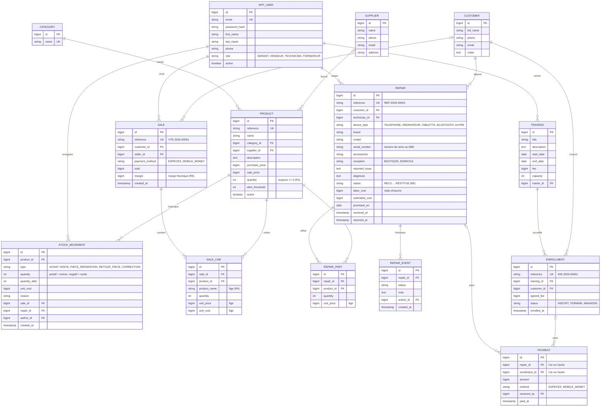

# Modèle de données

Base **PostgreSQL**, schéma versionné avec **Flyway** (`backend/src/main/resources/db/migration`). Montants en francs CFA entiers (`BIGINT`).

## Choix de conception

- **Quantité dénormalisée + mouvements** : `product.quantity` permet d'afficher le stock instantanément ; chaque modification passe par un service qui crée le `STOCK_MOVEMENT` dans la même transaction (R2). Une contrainte `CHECK (quantity >= 0)` protège la base même en cas de bug (R1).
- **Verrouillage pessimiste** (`SELECT … FOR UPDATE`) des produits pendant une vente ou l'ajout d'une pièce (R3), toujours dans l'ordre des identifiants pour éviter les interblocages.
- **Prix figés** dans `SALE_LINE` et `REPAIR_PART` (R4) ; `unit_cost` permet de calculer la marge même si le prix d'achat change ensuite.
- **Paiements partagés** : une seule table `PAYMENT` pour les acomptes de réparation et les paiements de formation, avec une contrainte qui impose exactement l'un des deux liens.
- **Clients uniques** : un même client peut acheter, déposer un appareil et suivre une formation ; son historique est complet.
