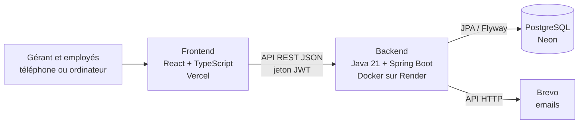

# Architecture technique



| Couche | Technologie | Rôle |
|---|---|---|
| Interface | React 19, TypeScript, Vite, Tailwind CSS, React Router, TanStack Query | Écrans de gestion, responsive |
| API | Java 21, Spring Boot 4 (Web MVC, Validation), REST | Règles métier, contrôles |
| Sécurité | Spring Security, JWT, BCrypt | Authentification et droits par rôle |
| Données | Spring Data JPA, PostgreSQL, Flyway | Stockage et évolutions du schéma |
| Tests | JUnit 5, Mockito, MockMvc ; Vitest, Testing Library | TDD, non-régression |
| Livraison | Docker, GitHub Actions | Conteneur, intégration continue |

## Organisation du backend (par fonctionnalité)

```
backend/src/main/java/com/milatech/
├── auth/        Connexion, jetons JWT, mot de passe oublié
├── user/        Employés et rôles
├── catalog/     Catégories, fournisseurs, produits
├── stock/       Mouvements de stock, alertes
├── customer/    Clients et historique
├── sale/        Ventes, reçus PDF, marges
├── repair/      Réparations, pièces, bons de dépôt
├── training/    Formations, inscriptions
├── payment/     Paiements (réparations, formations)
├── dashboard/   Indicateurs du tableau de bord
└── common/      Erreurs, configuration, outils partagés
```

Chaque fonctionnalité suit le même découpage :

```
Controller (REST, validation des entrées)
   → Service (règles métier, transactions)
      → Repository (Spring Data JPA)
         → Entity (table PostgreSQL)
```

- Les **DTO** (records Java) séparent l'API des entités.
- Les erreurs métier renvoient un message clair en français (`400`, `403`, `404`, `409`).
- Les **services** sont testés avec **Mockito** (sans base) ; les **contrôleurs** et les règles de stock avec **MockMvc** et une vraie base (H2 en local, PostgreSQL dans l'intégration continue).

## Organisation du frontend

```
frontend/src/
├── api/          Client HTTP (jeton, erreurs) et appels par fonctionnalité
├── components/   Composants partagés (boutons, champs, tableaux, mise en page)
├── features/     Un dossier par module : stock, ventes, réparations, formations…
├── hooks/        Hooks partagés
└── lib/          Formatage (FCFA, dates), règles d'affichage
```

## Environnements

| | Développement | Intégration continue | Production |
|---|---|---|---|
| Base | H2 en mémoire (mode PostgreSQL) | PostgreSQL 17 (service GitHub Actions) | PostgreSQL (Neon) |
| Backend | `./mvnw spring-boot:run` | `./mvnw verify` | Docker sur Render |
| Frontend | `npm run dev` (Vite) | `npm run lint && npm test && npm run build` | Vercel |

Aucun secret dans le code : tout ce qui change entre les environnements (base, clé JWT, clé Brevo, adresse du site) est lu dans les **variables d'environnement**.
